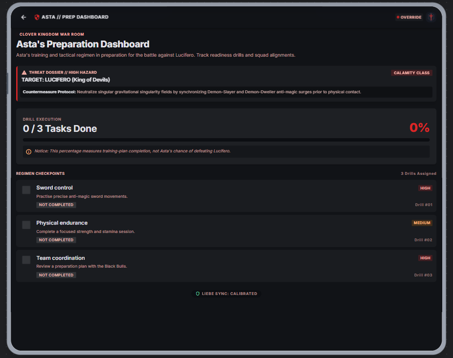
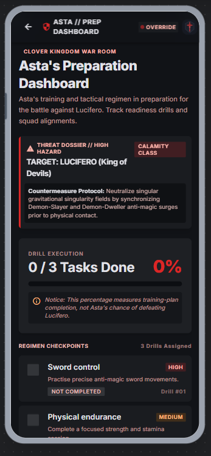
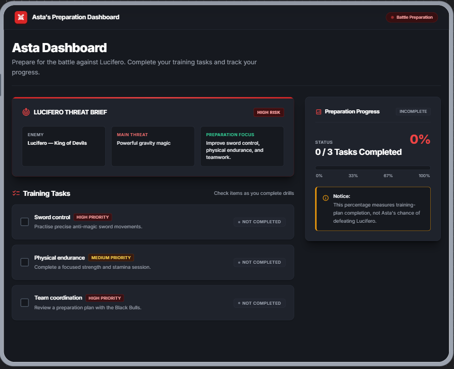
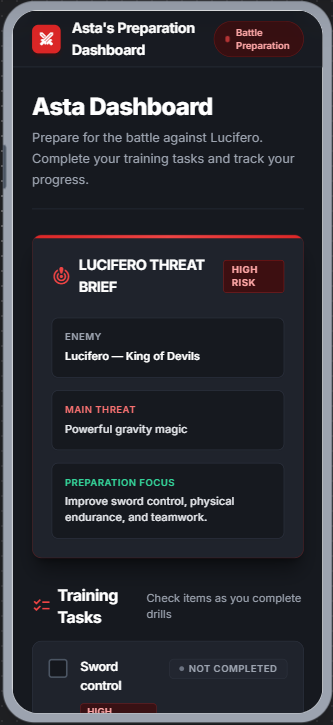

# Design Decisions - Asta's Preparation Dashboard

## 1. Design Overview

I used Google Stitch to explore the design for Asta's Preparation Dashboard.

My goal was to create a simple, responsive dashboard that combines a modern interface with a dark fantasy theme inspired by Black Clover.

I generated an initial design, reviewed it, and refined it to improve readability, spacing, and usability.

## 2. Dashboard Sections

The selected design contains:

- **Header:** Displays the dashboard name.
- **Introduction:** Briefly explains Asta's preparation goal.
- **Lucifero Threat Brief:** Summarizes the enemy, main threat, and training focus.
- **Training Tasks:** Displays the three predefined tasks, their descriptions, priorities, completion status, and checkboxes.
- **Preparation Progress:** Shows the completed/total count, percentage, progress bar, and a note explaining what the percentage represents.

## 3. Colors

I chose a dark color palette inspired by the story while keeping the interface readable.

- **Background:** Dark charcoal.
- **Cards:** Slightly lighter charcoal to separate content.
- **Primary text:** Warm white for headings and task names.
- **Secondary text:** Light gray for descriptions.
- **Accent:** Red for important details such as threat levels and high-priority tasks.
- **Additional accents:** Amber for medium priority and green for the preparation focus.

I kept the red accents limited so the interface would not feel too crowded.

## 4. Typography

I chose a clean, modern sans-serif font style.

- Larger, bold text for the main dashboard title.
- Clear headings for each section.
- Readable text for task descriptions.
- Smaller labels for priorities and completion status.

The goal is to make important information easy to find at a glance.

## 5. Spacing and Layout

The dashboard uses spacing between sections and padding inside cards to separate information clearly.

On desktop, the training tasks and progress summary are displayed in separate columns.

On mobile, the intended layout is a single column with vertical scrolling so all three tasks remain accessible.

## 6. Design Refinement

After reviewing the first Stitch design, I noticed several problems:

- Some text was too small and difficult to read.
- Too much red was used for descriptions.
- The sections felt crowded.
- The Lucifero threat description was unnecessarily complicated.
- Some interface elements were not required by the PRD.

I refined the design by:

- Simplifying the introduction and Lucifero threat brief.
- Improving text contrast and readability.
- Adding more spacing between sections.
- Making the training task cards clearer.
- Removing unnecessary decorative controls.
- Using simpler section names.

**Reason for the changes:**

I wanted the dashboard to be easier to understand and use, especially for someone who is not familiar with Black Clover.

### Final Design Selection

After exploring several designs in Stitch, I selected the desktop
and mobile versions that best matched my PRD.

I chose these versions because they have a consistent dark theme,
clear training cards, readable progress information, and an
organized layout.

I preferred these designs over some later versions because they
were easier to read and better organized.

## 7. Design Evidence

The following screenshots show the original design and the refined version.

### Initial Desktop Design

### Initial Mobile Design

### Reviewed Desktop Design

### Reviewed Mobile Design

## 8. Design Limitations

The Stitch designs are visual references, not proof that the dashboard works.

The checkbox interactions, progress calculations, responsiveness, and keyboard accessibility will need to be implemented and tested in the Next.js application.