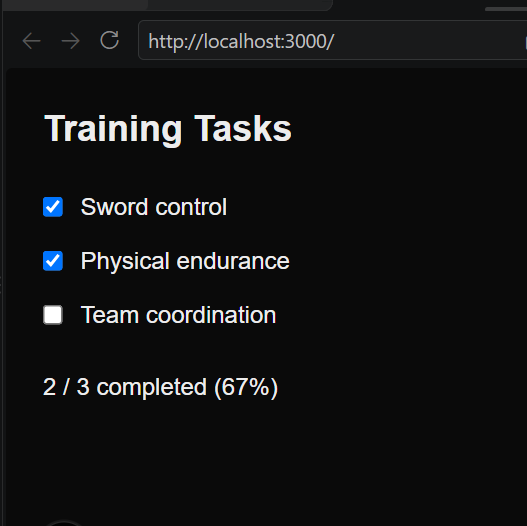

# Proof of Concept Training Progress

## 1. Question

Can task completion and the progress summary stay consistent when tasks are completed, undone, and toggled repeatedly?

## 2. Approach

I built a small proof of concept using Next.js, TypeScript, and React.

The experiment includes three predefined training tasks:

- Sword control
- Physical endurance
- Team coordination

Each task has a checkbox that allows the user to mark it as completed or undo its completion.

The completion status of the three tasks is stored in one React state array. The completed-task count is calculated from that state, and the progress percentage is derived using:

`Math.round((completed / total) * 100)`

This keeps the task states, completed count, and percentage consistent without maintaining separate state values for each calculation.

The interactive logic is implemented in a Client Component.

## 3. Test Results

| Test | Expected Result | Actual Result | Status |
|---|---|---|---|
| Start with no tasks completed | 0 / 3 — 0% | 0 / 3 — 0% | Pass |
| Complete one task | 1 / 3 — 33% | 1 / 3 — 33% | Pass |
| Complete two tasks | 2 / 3 — 67% | 2 / 3 — 67% | Pass |
| Complete all three tasks | 3 / 3 — 100% | 3 / 3 — 100% | Pass |
| Undo one completed task | 2 / 3 — 67% | 2 / 3 — 67% | Pass |
| Toggle the same task repeatedly | Count remains between 0 and 3 and matches the checkboxes | Count remained within range and reflected the checked tasks | Pass |

All six tests were performed manually in the browser and passed.

## 4. Observation

The completed count and percentage stayed synchronized with the checkbox states during testing.

Using one source of truth for task completion avoids inconsistencies that could occur if the count and percentage were updated separately.

The interface uses minimal styling because the purpose of this experiment is to verify the core interaction, not to implement the final dashboard design.

## 5. Decision

**Continue to MVP development.**

The POC demonstrated that the required task completion and progress calculation work correctly.

The interaction can be reused in the final Asta's Preparation Dashboard.

## 6. Evidence

